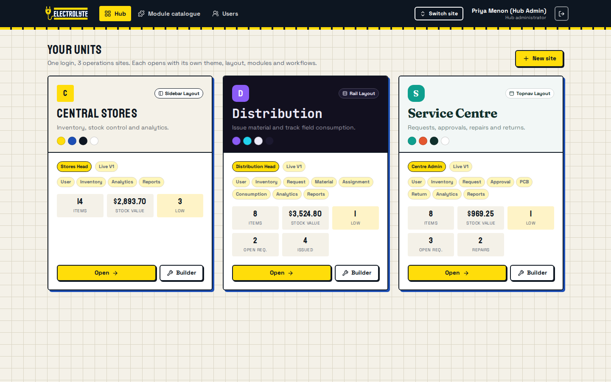

# OpsHub - one modular hub that runs many different operations sites

Electrolyte hackathon, **PS 03**. One codebase, one login, N completely different sites (theme, layout, modules, fields, workflows), each with an isolated backend. A visual builder lets a non-developer configure a site and publish it live with no code change and no restart.



## What is in the box

| Layer | What it does | Where |
|---|---|---|
| **Hub** | Global JWT login (bcrypt), roles, user management, site switcher, theme engine, module catalogue, cross-unit overview | `client/src/pages`, `server/src/routes/hub.js` |
| **Site** | `{ siteId, slug, theme, modules, pages, roles }` stored as JSONB, rendered by ONE renderer in 3 layouts | `client/src/renderer`, `shared/` |
| **Module / node** | 13 typed nodes with inputs, outputs, dependencies, default fields, permissions | `shared/registry.js` |
| **Builder** | React Flow canvas: drag, typed connections, presets, field + formula editor, preview, publish, rollback | `client/src/builder` |
| **API** | `/api/:siteId/:resource`, per-module and per-role gating, transactional workflows, Excel | `server/src` |
| **DB** | PostgreSQL, `site_id` on every business table, **forced Row Level Security**, composite FKs | `server/src/migrations/001_schema.sql` |

Architecture diagram: [`docs/architecture.svg`](docs/architecture.svg). More: [`docs/MODULE_REGISTRY.md`](docs/MODULE_REGISTRY.md), [`docs/DATA_MODEL_AND_API.md`](docs/DATA_MODEL_AND_API.md), [`docs/DEMO_SCRIPT.md`](docs/DEMO_SCRIPT.md).

## Quick start on Windows (PowerShell or cmd)

Requirements: **Node 22 LTS** (https://nodejs.org) and, for the full setup, **PostgreSQL 14+** (https://www.postgresql.org/download/windows, remember the `postgres` password you choose during install). No `psql`, `createdb`, `cp` or Unix tools are needed.

**Fastest path (no PostgreSQL at all):**
```powershell
npm run setup            # installs root (Husky git hooks), server, and client dependencies
npm run build
npm run start:offline    # http://localhost:4000 - seeded demo data, in-process PostgreSQL
```

**Full path with PostgreSQL:**
```powershell
copy .env.example .env       # then open .env and put YOUR postgres password in DATABASE_URL
npm run setup
npm run db:create            # creates the database "opshub" (connects with the .env credentials)
npm run db:migrate
npm run db:seed
npm run build
npm start                    # http://localhost:4000
```
Re-seed from scratch any time: `npm run db:seed -- --reset`.
Hot-reload development: run `npm run dev:server` and `npm run dev:client` in two terminals (open http://localhost:5173).

Troubleshooting on Windows:
* `password authentication failed` -> fix the password in `.env` (`DATABASE_URL=postgresql://postgres:<your-password>@localhost:5432/opshub`).
* `ECONNREFUSED 5432` -> PostgreSQL service is not running (Services -> postgresql-x64-XX -> Start), or just use `npm run start:offline`.
* `bcrypt` install error -> install the latest Node 22 LTS (a prebuilt Windows binary is bundled); do not use very old Node.
* Port 4000 busy -> set `PORT=4001` in `.env`.

## Quick start on macOS / Linux

```bash
cp .env.example .env         # edit DATABASE_URL if your postgres password differs
npm run setup
npm run db:create && npm run db:migrate && npm run db:seed
npm run build
npm start                    # http://localhost:4000
```
(or `docker compose up -d` for the database).

## SMS updates for public customers

A customer submits a request at `/s/service-centre/submit` with their mobile number. From then on the Service Centre texts them automatically:

| Step in the workflow | SMS the customer receives |
|---|---|
| Request submitted | "we have received your request SC-0012" (with a tracking link if `PUBLIC_BASE_URL` is set) |
| Manager approves / rejects | "Request approved, technician will start shortly" / "could not accept" (internal reason is never sent) |
| Repair job opened | "your device is with our technician, diagnosing" |
| Awaiting parts, repairing, testing | one text per stage change (never duplicated) |
| Repair completed | "repaired and ready for hand-back" |
| Handed back (Returns) | "handed back, thank you" |
| Cancelled | "request cancelled" |

Customers can also open `/s/service-centre/track`, enter the reference and the phone number they gave, and see a live progress bar plus every message sent. Staff see the full message history on each request (Requests, click a row) and managers can send a custom update or resend a failed one.

**Providers** (set `SMS_PROVIDER` in `server/.env`, then restart):

* `log` (default): prints `[SMS:log] -> +91...` in the server window and stores the message. No account needed, the whole flow is demonstrable.
* `twilio`: set `TWILIO_ACCOUNT_SID`, `TWILIO_AUTH_TOKEN`, `TWILIO_FROM`. Trial accounts can only text numbers verified in the Twilio console.
* `fast2sms`: set `FAST2SMS_API_KEY` (Indian 10-digit numbers).
* `webhook`: set `SMS_WEBHOOK_URL`; OpsHub POSTs `{ "to": "+91...", "message": "..." }` so any gateway (MSG91 etc.) can be plugged in.

Notes: in India, commercial SMS normally needs DLT-registered sender and templates, so for a hackathon demo use `log`, Twilio with a verified number, or a webhook to your own gateway. A failed SMS never blocks the workflow: the message is stored as *failed* with the reason and can be resent. Turn the feature on or off per site in the builder (Request module, "Send SMS updates to the customer").

**Upgrading an existing database:** run `npm run db:migrate` once (adds the `notifications` table). Offline mode needs nothing.

## Offline / no-database mode (demo safety net)

If Postgres is not available on the demo machine:

```bash
npm run setup && npm run build
npm run start:offline                # in-process PostgreSQL (PGlite), seeds itself, http://localhost:4000 (works on Windows too)
```

It runs the same schema, the same RLS policies and the same code. Data lives in memory and resets on restart.

Other backups: `backup/demo-snapshot.json` (restore with `npm run restore`) and `backup/opshub_demo.sql` (plain `psql` restore).

## Demo logins

| Email | Password | Role |
|---|---|---|
| admin@opshub.dev | Admin@123 | Hub admin (admin on every site) |
| storeadmin@opshub.dev | Demo@1234 | Central Stores admin only |
| stores@opshub.dev | Demo@1234 | Central Stores manager, Distribution member |
| servicemgr@opshub.dev | Demo@1234 | Service Centre manager |
| tech@opshub.dev | Demo@1234 | Service Centre member, Central Stores member |
| dispatch@opshub.dev | Demo@1234 | Distribution manager |
| field@opshub.dev | Demo@1234 | Distribution member |

Public (no login): the intake form at `/s/service-centre/submit` and the public site directory on the login page.

## How every PS requirement is met

| Requirement | Implementation | Proof |
|---|---|---|
| One login + hub listing all units + switcher | `/` hub, `SiteSwitcher`, global JWT | e2e browser run, `excel_fields.test.js` hub test |
| `site_id` isolation across sites, ORM **and** DB | `ScopedRepo` always injects `site_id`; RLS `FORCE`d on all 11 business tables; composite FKs | `isolation.test.js` (11 tests incl. a table over **every endpoint**) |
| 13 modules as typed nodes in a registry | `shared/registry.js` | `docs/MODULE_REGISTRY.md`, catalogue page |
| Builder with drag, typed connections, presets, persistence | React Flow, `shared/validate.js`, autosave to `sites.draft_config` | `builder.test.js`, screenshot below |
| "Approval can't be added without Request" | `canAddModule` (UI) + `validateConfig` (server, blocks publish) | `builder.test.js` |
| UI + data handling generated from config | `DynamicForm`, `entities.js` field engine, one renderer | Service Centre vs Central Stores vs Distribution |
| Request -> approval -> assignment with transactional stock | `issueAssignment`: row locks + one transaction + `UNIQUE(site_id, request_id)` + `CHECK(qty>=0)` | rollback test, **8 concurrent assigns -> 1 winner**, no-oversell test |
| Calculated fields (TOTAL = QTY x PRICE) with schema validation | `shared/formula.js` (safe parser, no eval), cycle + reference + type checks | `excel_fields.test.js`, `builder.test.js` |
| Preview, publish, versioned releases, rollback, deploy history | `site_versions`, `deploy_history`, read-only preview header | `builder.test.js` |
| Per-site analytics (Recharts) | `/analytics`, widgets chosen per site | Analytics page |
| Excel import/export with role restrictions | ExcelJS, formulas exported as real Excel formulas, per-site min roles | `excel_fields.test.js` |
| Roles Public / Member / Manager / Admin | `guard(module, action)` with per-site overrides | isolation + workflow tests |
| Adding a module to a live site, no restart | publish swaps the cached config pointer | Demo step 3 (verified in a real browser) |

## Tests

```bash
npm test                  # 45 tests, ~40 s. Creates and resets the "opshub_test" database using .env.test
                          # (needs PostgreSQL running; default password "postgres" - edit server/.env.test otherwise)
```

## Commit standards (Conventional Commits)

This repository enforces the [Conventional Commits](https://www.conventionalcommits.org/) specification on all git commits using **Husky** and **Commitlint**. Non-conforming commit messages are automatically rejected by the `commit-msg` hook.

### Format
```text
<type>(<optional scope>): <description>
```

### Common types
- `feat:` A new user-facing feature (e.g. `feat(builder): add multi-node drag selection`)
- `fix:` A bug fix (e.g. `fix(builder): prevent node teleport on mouse release`)
- `refactor:` Code restructuring without behavioral changes (e.g. `refactor(db): streamline query helper`)
- `perf:` Performance improvements (e.g. `perf(renderer): optimize memoized canvas nodes`)
- `docs:` Documentation updates only (e.g. `docs: add commit standards to README`)
- `test:` Adding or updating tests (e.g. `test(auth): add login rate limiter test`)
- `chore:` Dependency bumps, tooling, or build configuration (e.g. `chore: configure husky and commitlint`)

### Example
```bash
git commit -m "fix(switcher): prevent dropdown from overflowing screen bottom"
```
*(If a message does not follow this format, e.g. `git commit -m "updated stuff"`, Git will reject the commit).*

### Team setup
When teammates clone this repository and run `npm run setup` (or `npm install`), the `"prepare": "husky"` script runs automatically. It installs `@commitlint/cli`, `@commitlint/config-conventional`, and sets up the Git hooks in their local `.git/hooks` directory. No manual hook configuration is needed.

## Project layout

```
shared/    registry, validation, formula engine, presets (imported by client AND server)
server/    Express API, migrations, seed, backup/restore, tests
client/    React + Vite + Tailwind app (hub, renderer, builder)
backup/    demo snapshot (JSON) and SQL dump
docs/      architecture, registry, data model + API, demo script, screenshots
```

## Design notes

* **Electrolyte look**: derived from the official logo (navy plate `#0D1621`, electric yellow `#FFDD0A`, cobalt shadow `#1D4FB5`, blocky condensed type). Hub chrome uses bold outlines and offset shadows; each site then re-themes through CSS variables.
* **Scope is frozen to the 13 modules.** No extra modules were added.
* Preview is read-only on purpose; releases change configuration, never data.
* Known limits (prototype): single-process config cache (clear on publish; for multi-instance use a pub/sub invalidation), in-memory rate limiter, no email flows.
